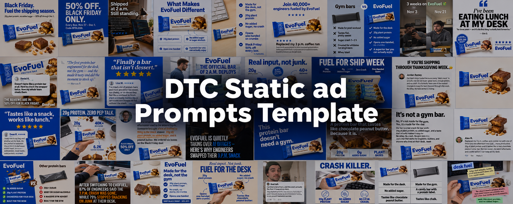

# DTC 靜態廣告提示詞庫

為直接面向消費者品牌整理的 40 組完整靜態廣告範本。

## 📚 簡介

這份純文字範本庫適合實體消費品品牌的 DTC 行銷人員與創意團隊。依六類創意形式瀏覽，複製完整英文提示詞，再填入自己的品牌與產品資料。全部 40 組範本內文完整保留，使用說明另行整理。

## ⚡ 快速開始

1. 依照想傳達的訊息與需要的版面，從下方完整目錄選擇範本。
2. 準備品牌視覺與語氣、產品事實、已確認的文案，以及該範本需要的參考圖片。
3. 複製整段提示詞，在獨立的工作副本中填入方括號內的輸入項。依據廣告簡報逐項核對畫面中的主張。
4. 將填好的提示詞用於支援所需輸入的圖像工具，依提示詞內文設定長寬比，並檢查生成結果。

可重複使用的簡報、參考圖片要求與各範本的例外，請閱讀獨立使用指南。所有語言版本的提示詞內文皆保留英文。

[閱讀使用指南](docs/usage.md)

## 🗞️ 更新紀錄

2026-11-05 — 首個純文字版本：六個分類、40 組範本與獨立使用說明。

## 📑 目錄

所有分類與語言版本皆使用相同且固定的案例編號。

- [簡介](#introduction)
- [快速開始](#quick-start)
- [更新紀錄](#news)
- [目錄](#menu)
- [相關資源](#related-resources)
- [致謝](#acknowledge)
- [範例圖庫](#static-examples)

**[訊息與優惠](cases/zh-TW/messaging-offers.md) · 6 組範本**

以標題、優惠、品牌宣言和鮮明主張為核心的版面。

- [Case 1: 大標題](cases/zh-TW/messaging-offers.md#messaging-offers-case-1)
- [Case 2: 優惠與促銷](cases/zh-TW/messaging-offers.md#messaging-offers-case-2)
- [Case 21: 鮮明主張與反應式標題](cases/zh-TW/messaging-offers.md#messaging-offers-case-21)
- [Case 23: 長篇品牌宣言與書信廣告](cases/zh-TW/messaging-offers.md#messaging-offers-case-23)
- [Case 30: 主視覺宣言與圖示賣點欄](cases/zh-TW/messaging-offers.md#messaging-offers-case-30)
- [Case 37: 主視覺宣言、圖示欄與優惠爆炸貼（促銷變體）](cases/zh-TW/messaging-offers.md#messaging-offers-case-37)

**[評價與社會認同](cases/zh-TW/testimonials-social-proof.md) · 10 組範本**

使用者證言、留言、評價卡片與社會認同版面。

- [Case 3: 使用者證言](cases/zh-TW/testimonials-social-proof.md#testimonials-social-proof-case-3)
- [Case 6: 社會認同](cases/zh-TW/testimonials-social-proof.md#testimonials-social-proof-case-6)
- [Case 9: 負向行銷（先抑後揚）](cases/zh-TW/testimonials-social-proof.md#testimonials-social-proof-case-9)
- [Case 11: 引言式評價卡片](cases/zh-TW/testimonials-social-proof.md#testimonials-social-proof-case-11)
- [Case 15: 社群留言截圖與產品](cases/zh-TW/testimonials-social-proof.md#testimonials-social-proof-case-15)
- [Case 16: 好奇心缺口與懸念引言證言](cases/zh-TW/testimonials-social-proof.md#testimonials-social-proof-case-16)
- [Case 17: 已驗證評價卡片](cases/zh-TW/testimonials-social-proof.md#testimonials-social-proof-case-17)
- [Case 19: 螢光標記與註解式使用者證言](cases/zh-TW/testimonials-social-proof.md#testimonials-social-proof-case-19)
- [Case 24: 產品與留言標註（模擬社會認同）](cases/zh-TW/testimonials-social-proof.md#testimonials-social-proof-case-24)
- [Case 38: UGC 生活情境、產品與評價卡片（分欄）](cases/zh-TW/testimonials-social-proof.md#testimonials-social-proof-case-38)

**[賣點與數據](cases/zh-TW/benefits-data.md) · 8 組範本**

賣點清單、標註、統計數據與產品資訊版面。

- [Case 4: 功能與賣點標註](cases/zh-TW/benefits-data.md#benefits-data-case-4)
- [Case 5: 項目符號賣點清單](cases/zh-TW/benefits-data.md#benefits-data-case-5)
- [Case 13: 環繞數據與放射標註（產品主視覺）](cases/zh-TW/benefits-data.md#benefits-data-case-13)
- [Case 18: 環繞數據與放射標註（生活情境平鋪）](cases/zh-TW/benefits-data.md#benefits-data-case-18)
- [Case 26: 數據標註（數據驅動的生活情境）](cases/zh-TW/benefits-data.md#benefits-data-case-26)
- [Case 27: 賣點清單展示（產品與資訊分欄）](cases/zh-TW/benefits-data.md#benefits-data-case-27)
- [Case 28: 功能箭頭標註與產品註解](cases/zh-TW/benefits-data.md#benefits-data-case-28)
- [Case 35: 產品主視覺展示與數據欄](cases/zh-TW/benefits-data.md#benefits-data-case-35)

**[比較與前後變化](cases/zh-TW/comparisons-transformations.md) · 5 組範本**

左右比較、表格與前後變化版面。

- [Case 7: 我們與其他選擇](cases/zh-TW/comparisons-transformations.md#comparisons-transformations-case-7)
- [Case 8: 前後對比（UGC 原生風格）](cases/zh-TW/comparisons-transformations.md#comparisons-transformations-case-8)
- [Case 25: 品牌與其他選擇的分色比較](cases/zh-TW/comparisons-transformations.md#comparisons-transformations-case-25)
- [Case 31: 比較網格與表格](cases/zh-TW/comparisons-transformations.md#comparisons-transformations-case-31)
- [Case 36: 白板前後對比與手持產品](cases/zh-TW/comparisons-transformations.md#comparisons-transformations-case-36)

**[編輯內容與原生形式](cases/zh-TW/editorial-native.md) · 7 組範本**

媒體、編輯內容、限時動態、備忘錄與好奇心驅動的形式。

- [Case 10: 媒體與編輯風格](cases/zh-TW/editorial-native.md#editorial-native-case-10)
- [Case 20: 廣編與編輯內容卡片](cases/zh-TW/editorial-native.md#editorial-native-case-20)
- [Case 29: UGC 與熱門貼文疊層](cases/zh-TW/editorial-native.md#editorial-native-case-29)
- [Case 32: UGC 限時動態標註與文字氣泡解說](cases/zh-TW/editorial-native.md#editorial-native-case-32)
- [Case 33: 模擬媒體與新聞文章截圖](cases/zh-TW/editorial-native.md#editorial-native-case-33)
- [Case 34: 模擬 iPhone 備忘錄與應用程式截圖](cases/zh-TW/editorial-native.md#editorial-native-case-34)
- [Case 39: 好奇心缺口與吸睛開場](cases/zh-TW/editorial-native.md#editorial-native-case-39)

**[生活情境與產品展示](cases/zh-TW/lifestyle-product.md) · 4 組範本**

動作情境、產品系列、套裝、風味故事與自然隨拍式產品展示。

- [Case 12: 生活動作情境與產品配色陣列](cases/zh-TW/lifestyle-product.md#lifestyle-product-case-12)
- [Case 14: 套裝展示與賣點橫欄](cases/zh-TW/lifestyle-product.md#lifestyle-product-case-14)
- [Case 22: 風味故事與口味聯想](cases/zh-TW/lifestyle-product.md#lifestyle-product-case-22)
- [Case 40: 原生粗獷便利貼風格（產品主視覺）](cases/zh-TW/lifestyle-product.md#lifestyle-product-case-40)

## 🖼️ 範例圖庫

40 組範本皆有主要範例圖。Case 37 的提示詞頁另附一個替代版本。可開啟原尺寸圖片，或閱讀對應提示詞。

> 由使用者提供的示意範例圖。圖中的文案、數字、評價與媒體風格呈現皆屬創意範例，不代表已驗證的產品事實或廣告活動成效。

<table>
<tr>
<td width="50%" valign="top">

<strong>Case 1: 大標題</strong>

<a href="cases/zh-TW/messaging-offers.md#messaging-offers-case-1">閱讀對應提示詞</a>

</td>
<td width="50%" valign="top">

<strong>Case 2: 優惠與促銷</strong>

<a href="cases/zh-TW/messaging-offers.md#messaging-offers-case-2">閱讀對應提示詞</a>

</td>
</tr>
<tr>
<td width="50%" valign="top">

<strong>Case 3: 使用者證言</strong>

<a href="cases/zh-TW/testimonials-social-proof.md#testimonials-social-proof-case-3">閱讀對應提示詞</a>

</td>
<td width="50%" valign="top">

<strong>Case 4: 功能與賣點標註</strong>

<a href="cases/zh-TW/benefits-data.md#benefits-data-case-4">閱讀對應提示詞</a>

</td>
</tr>
<tr>
<td width="50%" valign="top">

<strong>Case 5: 項目符號賣點清單</strong>

<a href="cases/zh-TW/benefits-data.md#benefits-data-case-5">閱讀對應提示詞</a>

</td>
<td width="50%" valign="top">

<strong>Case 6: 社會認同</strong>

<a href="cases/zh-TW/testimonials-social-proof.md#testimonials-social-proof-case-6">閱讀對應提示詞</a>

</td>
</tr>
<tr>
<td width="50%" valign="top">

<strong>Case 7: 我們與其他選擇</strong>

<a href="cases/zh-TW/comparisons-transformations.md#comparisons-transformations-case-7">閱讀對應提示詞</a>

</td>
<td width="50%" valign="top">

<strong>Case 8: 前後對比（UGC 原生風格）</strong>

<a href="cases/zh-TW/comparisons-transformations.md#comparisons-transformations-case-8">閱讀對應提示詞</a>

</td>
</tr>
<tr>
<td width="50%" valign="top">

<strong>Case 9: 負向行銷（先抑後揚）</strong>

<a href="cases/zh-TW/testimonials-social-proof.md#testimonials-social-proof-case-9">閱讀對應提示詞</a>

</td>
<td width="50%" valign="top">

<strong>Case 10: 媒體與編輯風格</strong>

<a href="cases/zh-TW/editorial-native.md#editorial-native-case-10">閱讀對應提示詞</a>

</td>
</tr>
<tr>
<td width="50%" valign="top">

<strong>Case 11: 引言式評價卡片</strong>

<a href="cases/zh-TW/testimonials-social-proof.md#testimonials-social-proof-case-11">閱讀對應提示詞</a>

</td>
<td width="50%" valign="top">

<strong>Case 12: 生活動作情境與產品配色陣列</strong>

<a href="cases/zh-TW/lifestyle-product.md#lifestyle-product-case-12">閱讀對應提示詞</a>

</td>
</tr>
<tr>
<td width="50%" valign="top">

<strong>Case 13: 環繞數據與放射標註（產品主視覺）</strong>

<a href="cases/zh-TW/benefits-data.md#benefits-data-case-13">閱讀對應提示詞</a>

</td>
<td width="50%" valign="top">

<strong>Case 14: 套裝展示與賣點橫欄</strong>

<a href="cases/zh-TW/lifestyle-product.md#lifestyle-product-case-14">閱讀對應提示詞</a>

</td>
</tr>
<tr>
<td width="50%" valign="top">

<strong>Case 15: 社群留言截圖與產品</strong>

<a href="cases/zh-TW/testimonials-social-proof.md#testimonials-social-proof-case-15">閱讀對應提示詞</a>

</td>
<td width="50%" valign="top">

<strong>Case 16: 好奇心缺口與懸念引言證言</strong>

<a href="cases/zh-TW/testimonials-social-proof.md#testimonials-social-proof-case-16">閱讀對應提示詞</a>

</td>
</tr>
<tr>
<td width="50%" valign="top">

<strong>Case 17: 已驗證評價卡片</strong>

<a href="cases/zh-TW/testimonials-social-proof.md#testimonials-social-proof-case-17">閱讀對應提示詞</a>

</td>
<td width="50%" valign="top">

<strong>Case 18: 環繞數據與放射標註（生活情境平鋪）</strong>

<a href="cases/zh-TW/benefits-data.md#benefits-data-case-18">閱讀對應提示詞</a>

</td>
</tr>
<tr>
<td width="50%" valign="top">

<strong>Case 19: 螢光標記與註解式使用者證言</strong>

<a href="cases/zh-TW/testimonials-social-proof.md#testimonials-social-proof-case-19">閱讀對應提示詞</a>

</td>
<td width="50%" valign="top">

<strong>Case 20: 廣編與編輯內容卡片</strong>

<a href="cases/zh-TW/editorial-native.md#editorial-native-case-20">閱讀對應提示詞</a>

</td>
</tr>
<tr>
<td width="50%" valign="top">

<strong>Case 21: 鮮明主張與反應式標題</strong>

<a href="cases/zh-TW/messaging-offers.md#messaging-offers-case-21">閱讀對應提示詞</a>

</td>
<td width="50%" valign="top">

<strong>Case 22: 風味故事與口味聯想</strong>

<a href="cases/zh-TW/lifestyle-product.md#lifestyle-product-case-22">閱讀對應提示詞</a>

</td>
</tr>
<tr>
<td width="50%" valign="top">

<strong>Case 23: 長篇品牌宣言與書信廣告</strong>

<a href="cases/zh-TW/messaging-offers.md#messaging-offers-case-23">閱讀對應提示詞</a>

</td>
<td width="50%" valign="top">

<strong>Case 24: 產品與留言標註（模擬社會認同）</strong>

<a href="cases/zh-TW/testimonials-social-proof.md#testimonials-social-proof-case-24">閱讀對應提示詞</a>

</td>
</tr>
<tr>
<td width="50%" valign="top">

<strong>Case 25: 品牌與其他選擇的分色比較</strong>

<a href="cases/zh-TW/comparisons-transformations.md#comparisons-transformations-case-25">閱讀對應提示詞</a>

</td>
<td width="50%" valign="top">

<strong>Case 26: 數據標註（數據驅動的生活情境）</strong>

<a href="cases/zh-TW/benefits-data.md#benefits-data-case-26">閱讀對應提示詞</a>

</td>
</tr>
<tr>
<td width="50%" valign="top">

<strong>Case 27: 賣點清單展示（產品與資訊分欄）</strong>

<a href="cases/zh-TW/benefits-data.md#benefits-data-case-27">閱讀對應提示詞</a>

</td>
<td width="50%" valign="top">

<strong>Case 28: 功能箭頭標註與產品註解</strong>

<a href="cases/zh-TW/benefits-data.md#benefits-data-case-28">閱讀對應提示詞</a>

</td>
</tr>
<tr>
<td width="50%" valign="top">

<strong>Case 29: UGC 與熱門貼文疊層</strong>

<a href="cases/zh-TW/editorial-native.md#editorial-native-case-29">閱讀對應提示詞</a>

</td>
<td width="50%" valign="top">

<strong>Case 30: 主視覺宣言與圖示賣點欄</strong>

<a href="cases/zh-TW/messaging-offers.md#messaging-offers-case-30">閱讀對應提示詞</a>

</td>
</tr>
<tr>
<td width="50%" valign="top">

<strong>Case 31: 比較網格與表格</strong>

<a href="cases/zh-TW/comparisons-transformations.md#comparisons-transformations-case-31">閱讀對應提示詞</a>

</td>
<td width="50%" valign="top">

<strong>Case 32: UGC 限時動態標註與文字氣泡解說</strong>

<a href="cases/zh-TW/editorial-native.md#editorial-native-case-32">閱讀對應提示詞</a>

</td>
</tr>
<tr>
<td width="50%" valign="top">

<strong>Case 33: 模擬媒體與新聞文章截圖</strong>

<a href="cases/zh-TW/editorial-native.md#editorial-native-case-33">閱讀對應提示詞</a>

</td>
<td width="50%" valign="top">

<strong>Case 34: 模擬 iPhone 備忘錄與應用程式截圖</strong>

<a href="cases/zh-TW/editorial-native.md#editorial-native-case-34">閱讀對應提示詞</a>

</td>
</tr>
<tr>
<td width="50%" valign="top">

<strong>Case 35: 產品主視覺展示與數據欄</strong>

<a href="cases/zh-TW/benefits-data.md#benefits-data-case-35">閱讀對應提示詞</a>

</td>
<td width="50%" valign="top">

<strong>Case 36: 白板前後對比與手持產品</strong>

<a href="cases/zh-TW/comparisons-transformations.md#comparisons-transformations-case-36">閱讀對應提示詞</a>

</td>
</tr>
<tr>
<td width="50%" valign="top">

<strong>Case 37: 主視覺宣言、圖示欄與優惠爆炸貼（促銷變體）</strong>

<a href="cases/zh-TW/messaging-offers.md#messaging-offers-case-37">閱讀對應提示詞</a>

</td>
<td width="50%" valign="top">

<strong>Case 38: UGC 生活情境、產品與評價卡片（分欄）</strong>

<a href="cases/zh-TW/testimonials-social-proof.md#testimonials-social-proof-case-38">閱讀對應提示詞</a>

</td>
</tr>
<tr>
<td width="50%" valign="top">

<strong>Case 39: 好奇心缺口與吸睛開場</strong>

<a href="cases/zh-TW/editorial-native.md#editorial-native-case-39">閱讀對應提示詞</a>

</td>
<td width="50%" valign="top">

<strong>Case 40: 原生粗獷便利貼風格（產品主視覺）</strong>

<a href="cases/zh-TW/lifestyle-product.md#lifestyle-product-case-40">閱讀對應提示詞</a>

</td>
</tr>
</table>

## 🔎 相關資源

- [閱讀使用指南](docs/usage.md)
- [閱讀維護指南](docs/maintenance.md)
- [瀏覽全部提示詞資料](data/prompts.json)
- [閱讀貢獻指南](CONTRIBUTING.md)

## 🙏 致謝

歡迎提出導覽、翻譯與使用說明的改善建議。修改範本內文前，請先閱讀貢獻指南。
